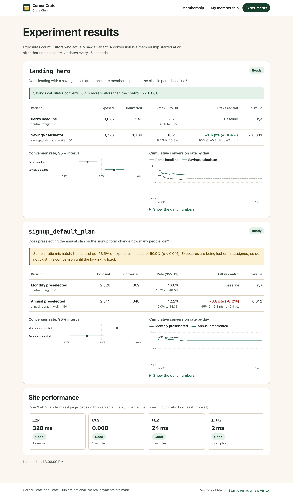

# member-lab

A front-end project about the parts of a paid membership that are hard to get right: the signup flow, A/B tests rendered in the browser, and a results page that tells you honestly whether a test won. Crate Club is the membership for Corner Crate, a made-up neighborhood delivery service. Visitors land on a page that is running an experiment, join with a free trial or an annual plan, and can bill or cancel from their member page.

It is built with React 19, TypeScript (strict), TanStack Query and Vite. A deliberately small GraphQL API in Node keeps data in memory and fills itself with simulated traffic on startup, so the results page has something to show.



Corner Crate, Crate Club, every price, perk and user are invented, and no real payment is ever made.

## Quickstart

```sh
npm install
npm run dev
```

Open http://localhost:5173. The API runs on port 4000 behind Vite's proxy. There are no keys, accounts or databases to set up.

To host it, create a Blueprint on [Render](https://render.com) from this repo. `render.yaml` sets up one always-on Starter web service ($7 a month) that builds the app and serves it with the API.

| Page | What to try |
| --- | --- |
| `/` | The hero is one of two experiment variants. "Start over as a new visitor" in the footer gets a new id, which may land in the other one. |
| `/join` | Pick a plan and a demo card. Card B is always declined. Double clicking the button is safe. |
| `/member` | Status, history, demo billing controls (end the trial, renew, fail a payment) and cancel. |
| `/experiments` | Live results for both experiments, a daily trend, and Web Vitals from your own page loads. |

## Walkthrough

The decisions worth talking about, in plain language.

**1. An exposure is logged when the variant is on screen, not when it is chosen.** Choosing a variant is a pure read. The component that draws the variant logs the exposure from an effect, and effects only run after React has put the component on the page. A visitor who leaves while the page is still loading is never counted. Counting them would add people who never saw the change, which waters down any real difference. A Strict Mode-safe guard stops repeat requests, and the server keeps only the first exposure anyway. ([useExposure.ts](src/experiments/useExposure.ts))

**2. Bucketing is a hash, so nothing needs storing.** `hash(salt:experiment:user) mod 10000` gives each visitor a stable number from 0 to 9,999, and the variants' weights split that range. Same visitor, same variant, on any server, forever. Changing the salt reshuffles everyone for a rerun. ([bucketing.ts](server/experiments/bucketing.ts))

**3. The results page answers "can I trust this, and did it win?"** In that order:
- *Sample ratio mismatch first.* With a 50/50 split, the control should get very close to half the exposures. If it gets 53.6% of 4,300, something is losing or misassigning exposures, and no comparison can be trusted. That warning replaces the verdict. The simulator plants exactly this bug in `signup_default_plan` so you can see it fire.
- *Then enough data.* Under 100 exposures per variant, the page says "collecting" instead of showing a winner.
- *Then the comparison.* Each rate gets a 95% Wilson interval, which behaves at low rates where the textbook formula breaks. The lift gets its own interval, and a two-proportion z-test gives the p-value. The verdict is one sentence a product manager can act on.
- *The trend chart* shows the cumulative rate by day. Early days swing a lot and then settle, which is why you decide on the full planned run, not on a promising day two. ([stats.ts](server/experiments/stats.ts), [Experiments.tsx](src/pages/Experiments.tsx))

**4. Cancel is optimistic, signup is not.** Cancelling almost always works, so the page shows "Cancelled" at once and puts the membership back if the server says no. Signup moves money and declines are common, so the page waits for the real answer rather than flash a membership that might vanish. Billing waits too: whether the charge works is the thing the visitor wants to know. ([hooks.ts](src/api/hooks.ts))

**5. A double click never charges twice.** The browser creates one idempotency key per user intent, such as "join monthly with card A", and sends the same key on every retry of that intent. That includes TanStack Query's automatic retries after a network error. The server runs a key once and replays its answer. Changing the form or getting an answer starts a new key. ([Join.tsx](src/pages/Join.tsx), [idempotency.ts](server/idempotency.ts))

**6. Server state lives in TanStack Query.** Every query key includes the visitor id, so starting over can never show the previous visitor's data. Prices and assignments are cached for the whole visit because they cannot change. Hovering the call to action prefetches the signup form's data, so the form appears instantly. The results page polls every 15 seconds, and polling pauses in background tabs.

**7. Performance is measured, not assumed.** The member and results pages are split into their own chunks, which start downloading when you hover their links. `npm run budget` fails CI if the entry script grows past 110 KB gzipped (it is about 98, mostly React). The app reports Core Web Vitals from real page loads with `sendBeacon`, and the results page shows their 75th percentile, which is how Google judges a page.

**8. Accessibility is tested, not just intended.** The cancel confirmation is the native `<dialog>`, which traps focus and closes on Escape for free. Focus moves to the main content on navigation and to the page heading after cancelling, async results are announced through live regions, and charts carry a text summary plus a data table. Every page in the Playwright journey is scanned with axe against WCAG 2.1 AA.

**9. The server is small on purpose.** It is a thin GraphQL layer over in-memory maps, so all the interesting work is in the browser. In production I would change three things: store memberships and idempotency keys in a real database (keys with an expiry), let a scheduler run renewals instead of a demo button, and use a lock that works across instances instead of an in-process one.

## How the pieces fit

```
src/            React app
  pages/        landing (two hero variants), join, member, experiment results
  api/          GraphQL client and TanStack Query hooks
  experiments/  exposure hook, cumulative series for the trend chart
  components/   charts, dialog, error boundary
server/         small GraphQL API
  experiments/  bucketing and stats: small pure modules, unit tested
  membership/   state machine and service (signup, billing, cancel)
  simulate/     seeded traffic so the results page has data
shared/         plan and experiment catalogs used by both sides
e2e/            Playwright journeys
ops/            alert rule
```

### Membership states

A first monthly membership starts as a 30-day free trial with no charge. Annual plans, and anyone who has had a trial, are charged at signup. Status changes only through one small transition table:

| From | Charge succeeds | Charge fails | Third failure in a row | Cancel |
| --- | --- | --- | --- | --- |
| `TRIAL` | `ACTIVE` | `PAST_DUE` | | `CANCELLED` |
| `ACTIVE` | `ACTIVE` | `PAST_DUE` | | `CANCELLED` |
| `PAST_DUE` | `ACTIVE` | `PAST_DUE` | `CANCELLED` | `CANCELLED` |

### Monitoring

The API logs one JSON line per request and exposes Prometheus metrics at `/metrics`: request rate and latency, GraphQL operations by outcome, and payment calls. A GraphQL error still answers HTTP 200, so the error rate is counted per operation.

### Alert: GraphQLErrorRateHigh

Defined in [`ops/alerts.yml`](ops/alerts.yml). It fires when more than 2% of GraphQL operations fail for 10 minutes, with enough traffic that one error at night does not page anyone. Declines are returned as data, not errors, so they do not count. To investigate: find the failing operation with `sum by (operation) (rate(graphql_operations_total{outcome="error"}[5m]))`, then search the logs for `unexpected GraphQL error`. If it is signup or billing, check `payment_charges_total{outcome="transient_error"}` for a payment provider outage. Clients retry with the same idempotency key, so nothing needs replaying once it is fixed.

### Settings

| Variable | Default | Does |
| --- | --- | --- |
| `PORT` | `4000` | API port |
| `SEED_VISITORS` | `24000` | Simulated visitors loaded at startup. `0` starts empty. |
| `PAYMENT_LATENCY_MS` | `150` | Fake payment provider latency |
| `PAYMENT_TRANSIENT_RATE` | `0` | Share of charges that time out (try `0.3` to watch retries) |
| `LOG_LEVEL` | `info` | Log level |

`npm run build && npm start` serves the built app and the API together on port 4000.

## Testing

```sh
npm run lint        # ESLint, strict type-checked rules, zero warnings allowed
npm run typecheck   # tsc, strict
npm test            # Vitest: unit, component and API tests
npm run build
npm run budget      # gzipped bundle size budget
npm run test:e2e    # Playwright, Chromium, against the built app
```

- **Component:** the landing page logs an exposure only after a variant renders, once, under Strict Mode, and never when the assignment fails. The member page shows a cancellation before the server answers and rolls it back, with a message, when the server refuses.
- **Unit:** bucketing (stable, in range, close to the weights), the stats against reference values, the cumulative series, every cell of the state machine, idempotent replays and double submits, and the membership service under declines and lost payment responses.
- **API:** the real HTTP server on a random port: signup, double submit, retry after a lost response (exactly one charge), cancel twice, exposure before and after conversion, Web Vitals beacons and `/metrics`.
- **End to end:** a Playwright journey lands, sees a variant, double clicks to join, closes the cancel dialog with Escape, cancels, and finds itself counted on the results page. Other journeys cover a declined card and starting over as a new visitor. Every page is checked with axe at WCAG 2.1 AA, and any console error fails the test.

CI runs all of it on every push and pull request, with no secrets. `npm run screenshot` refreshes the image above.

## How this was built

I built member-lab by directing AI coding agents (Claude Code). The spec, [SPEC.md](SPEC.md), came first: goals, non-goals and acceptance criteria. The agents wrote the code and tests against it, and lint, typecheck, unit and component tests, a bundle budget and a Playwright journey with accessibility checks gate every change.

## License

[MIT](LICENSE)
